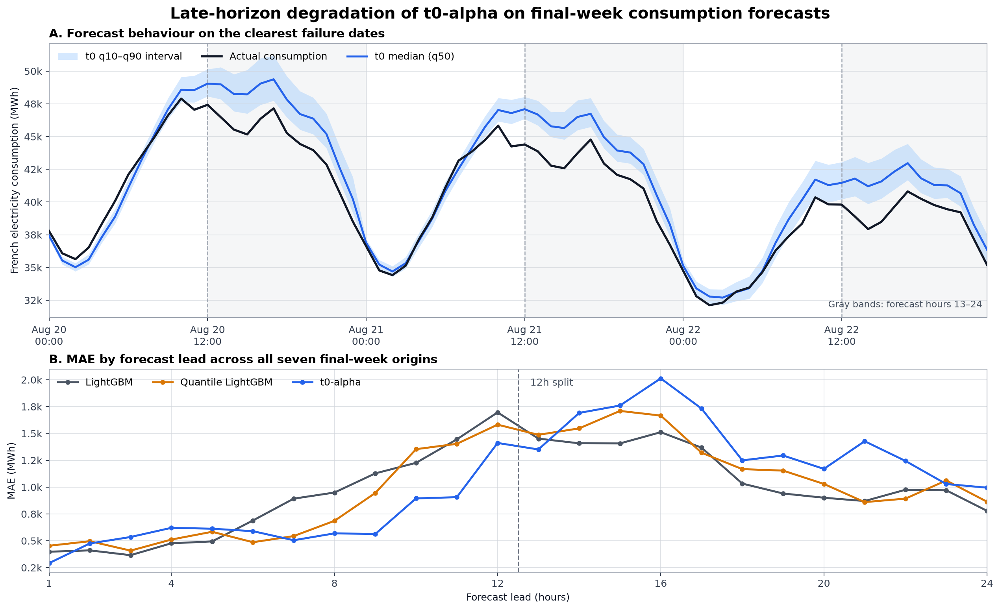

# Causal Energy Intelligence Platform

Clean-hour scheduling, decision ranking, and future causal analysis for carbon-aware workload shifting.

## Time-Series Foundation Model Benchmark — t0

### Headline results

The table uses the fixed 90-day, 24-hour consumption reference (`calendar_30d`)
and the matching 90-day scheduling evaluation. Lower is better except coverage,
whose nominal target is 80%. The benchmark reports mean pinball loss across the
10th/50th/90th quantiles rather than claiming CRPS from only three quantiles.

| Model | MAE / MASE ↓ | Mean pinball ↓ | 80% coverage | Carbon regret (gCO2e/kWh) ↓ | Median inference runtime |
| --- | ---: | ---: | ---: | ---: | ---: |
| Weekly seasonal naive | 2,382 / 0.683 | — | — | 1.736 | Not timed |
| LightGBM | 957 / 0.274 | — | — | 0.870 | 0.98 ms / target |
| LightGBM quantile | **905 / 0.260** | 310.6 | 65.6% | 0.822 | 3.00 ms / target |
| t0-alpha zero-shot | 927 / 0.266 | **307.9** | **77.7%** | **0.805** | 0.75 s / 10 targets |

**Key finding:** t0 delivered the best probabilistic forecast and lowest carbon
regret, while quantile LightGBM retained the best point accuracy; the winner
depends on whether the system values point error, calibrated uncertainty, or the
downstream carbon decision.

Runtime is end-to-end API latency for one t0 request containing all ten targets,
but local prediction time for one LightGBM target. It shows deployment cost, not
a hardware-normalized speed comparison.

**Scope:**

I evaluated Retrocast's `t0-alpha` as a zero-shot, multivariate time-series
foundation model for 24-hour-ahead forecasts of French electricity consumption,
total production, and eight generation sources. The benchmark also tests
covariates, 7/30/90-day context lengths, 6/12/24-hour horizons, missing and noisy
weather, unusual operating conditions, probabilistic calibration, and downstream
low-carbon workload scheduling.

**The Baselines:**

The primary trained baselines are fixed LightGBM point and quantile models, with
Ridge and 24-hour/168-hour seasonal-naive models as additional references. All
local models are benchmark-specific artifacts trained only on observations before
the evaluation period; t0 receives no fine-tuning.

**Dataset:**

Hourly national French electricity observations from ODRE: consumption, total
production, nuclear, gas, coal, oil, wind, solar, hydro, and bioenergy, joined
with historical weather and deterministic calendar signals. The final benchmark
uses source-cadence-aware MW-to-MWh aggregation: 30-minute historical actuals and
15-minute real-time actuals are integrated separately, with incomplete intervals
rejected rather than silently undercounted.

**Temporal evaluation protocol:**

Local training labels end at `2026-05-25 23:00 UTC`. Evaluation uses 90 daily
origins from May 26 through August 23, 2026, with a fixed 24-hour horizon and no
evaluation labels used for fitting or calibration. Results are reported over the
full 90 days and the nested final 28- and 7-day windows. All 90 origins are
eligible for 7-, 30-, and 90-day t0 contexts. The benchmark is retrospective:
historical publication vintages and possible foundation-model pretraining overlap
cannot be verified.

**Metrics**

MAE, RMSE, seasonal MASE, quantile pinball loss, central 80% interval coverage and
width, plus scheduling metrics: combined regret, carbon regret, cost regret,
top-5 overlap, best-hour capture, and carbon/cost savings versus immediate
execution.

**Observations:**

There was no universal winner. For consumption with the fixed calendar reference,
quantile LightGBM had the lowest 90-day MAE (`905 MWh` versus t0's `927 MWh`), t0
won the final 28 days (`792` versus `840 MWh`), and original LightGBM won the final
7 days (`991` versus t0's `1,039 MWh`). Across all ten targets, t0 beat original
LightGBM on 10/10 targets over 90 days, 9/10 over 28 days, and 7/10 over 7 days.
Original LightGBM produced the lowest combined scheduling regret in every window,
while t0 produced the lowest carbon regret and highest top-5 overlap.

**t0 Failure:**

Its 30-day calendar reference lost 90-day consumption MAE to quantile LightGBM
and final-week MAE to original LightGBM. Its nominal 80% consumption interval
covered only `52.4%` of final-week observations, showing severe undercoverage.
The benchmark also contains no cold, high-demand, or high-generation evaluation
hours under the frozen thresholds, so it cannot support claims in those regimes.

### Failure analysis — final-week late-horizon overprediction

The final-week loss was concentrated in the back half of the forecast rather
than spread evenly across all 24 leads:

| Model | Segment | MAE ↓ | Mean pinball ↓ | 80% coverage | Mean signed error |
| --- | --- | ---: | ---: | ---: | ---: |
| LightGBM | Hours 1–12 | 848 | — | — | +444 MWh |
| LightGBM | Hours 13–24 | 1,135 | — | — | +872 MWh |
| LightGBM quantile | Hours 1–12 | 788 | 285.2 | 58.3% | +348 MWh |
| LightGBM quantile | Hours 13–24 | 1,230 | 399.3 | 51.2% | +833 MWh |
| t0-alpha | Hours 1–12 | **665** | **220.8** | 57.1% | +219 MWh |
| t0-alpha | Hours 13–24 | 1,413 | 501.9 | 47.6% | +1,392 MWh |



*Late-horizon degradation of t0-alpha on final-week consumption forecasts.* t0
performs strongly over hours 1–12 (665 MWh MAE) but develops systematic positive
bias over hours 13–24 (1,413 MWh MAE). Despite wider prediction intervals,
nominal 80% coverage falls to 47.6% in the second half of the horizon. Panel A
shows August 20–22; Panel B covers all seven forecast origins from August 17–23.
This is a diagnostic pattern rather than evidence of a general seasonal effect.

t0 was strongest during hours 1–12, then its late-horizon MAE more than doubled
and its forecasts became systematically high. August 20–22 were the clearest
failures: late-horizon mean errors were approximately +2.0 to +2.3 GWh and daily
interval coverage fell to 16.7–33.3%. The interval widened in the second half but
still missed more than half the observations, so the failure was both a location
bias and an uncertainty-calibration failure. With only seven final-week origins,
this is a concrete diagnostic pattern, not evidence of a general seasonal law.

**t0 Excellence:**

Weather and longer history were especially useful for t0. Historical weather
reduced its consumption MAE to `850/721/765 MWh` over the 90/28/7-day windows,
beating both local model configurations in each window. A six-hour weather outage
raised original LightGBM's MAE by `21–38%` and quantile LightGBM's by `14–21%`,
while t0 remained effectively stable. A 90-day t0 context also beat its 30-day
context in every window. For scheduling, t0 consistently found a better low-carbon
shortlist even when LightGBM won the combined carbon/cost objective.

**Learnings:**

Foundation-model value depends on the input configuration, forecast horizon, and
downstream decision metric. Zero-shot t0 was strongest when it could use richer
history and covariates, while trained local models remained highly competitive on
the fixed reference task. Calibration and decision quality must be evaluated
separately from point accuracy. The exercise also exposed a historical energy
aggregation error, reinforcing that data-contract and temporal-validity audits
are part of the benchmark—not cleanup after it.

## Architecture

```text
External APIs / CSV sources
  -> Local ingestion + Dagster refresh skeleton
  -> Supabase/Postgres transformed tables or local processed files
  -> Feature Engineering
  -> Consumption, Production, Source Production Models
  -> Carbon Intensity Estimates
  -> Clean-Hour Decision Ranking
  -> Next-24h Future Recommendations
  -> Static Dashboard Data Contract
  -> Vercel-ready Frontend
  -> MLflow + Dagster Observability
  -> Causal Inference Engine (in progress)
```

## Repository Layout

- `orchestration/` — Dagster daily and quick refresh assets.
- `src/data/` — Extract, transform, and load utilities.
- `src/features/` — Feature engineering.
- `src/models/` — Forecast training, evaluation, saved artifacts, and future recommendation scoring.
- `src/causal/` — Causal DAGs, effect estimation, and counterfactuals.
- `src/optimization/` — Carbon-aware workload shifting.
- `src/monitoring/` — Metrics and observability helpers.
- `api/` — FastAPI application.
- `frontend/` — Vercel-ready clean-hour decision dashboard.
- `notebooks/` — EDA, forecasting, and causal analysis notebooks.
- `docker/` — Container and local compose setup.
- `k8s/` — Optional local Kubernetes manifests.
- `docs/` — Architecture, causal DAG, and project report notes.
- `db/` — Supabase/Postgres schema.

## Local Development

```bash
python -m venv .venv
source .venv/bin/activate
pip install -r requirements.txt
uvicorn api.main:app --reload
```

Health check:

```bash
curl http://localhost:8000/health
```

## Clean-Hour Dashboard

The frontend lives in `frontend/` and is Vercel-ready. Recommendations are read from the generated
static contract at `frontend/public/data/dashboard.json`; observed workload decisions are written
through the server-side `/api/workload-decisions` function. The dashboard prefers the operational
next-24-hour recommendation artifact when it exists, so it is meant to show future scheduling
decisions rather than historical validation rows.

The live recommendation view includes a trust/freshness banner, scenario and causal-adjusted basis
selectors, top-5 clean-hour recommendations, deterministic explanation text for each recommendation,
an active-reference carbon saving label, a historical backtesting summary, and a causal-vs-average
comparison panel. The previous-day audit tab compares settled recommendations with observed actuals
and adds per-row outcome verdicts once recommendation outcome artifacts are available.

```bash
make frontend-install
make operational-refresh
make frontend-dev
```

Production build:

```bash
make frontend-build
```

Vercel deployment:

- Set the Vercel project root directory to `frontend`.
- Use build command `npm run build`.
- Use output directory `dist`.
- Automatic Vercel Git deployments are disabled in `frontend/vercel.json`. Deploy through the scheduled GitHub Actions workflow so the generated live dashboard data is included.
- Set `SUPABASE_PROJECT_URL` and `SUPABASE_SERVICE_ROLE_KEY` in the Vercel production environment;
  never expose the service-role key through a `VITE_` variable. Optionally set
  `TREATMENT_ALLOWED_ORIGIN` to the exact production dashboard origin.
- The local/frontend build still includes a sample dashboard data contract if `frontend/public/data/dashboard.json` has not been generated. That keeps local builds healthy, but it is not the production deployment path.

Daily automated deployment uses GitHub Actions and Vercel CLI so generated
dashboard data does not need to be committed. Add these GitHub repository
secrets before enabling the scheduled deployment:

- `SUPABASE_DATABASE_URL`
- `VERCEL_TOKEN`
- `VERCEL_ORG_ID`
- `VERCEL_PROJECT_ID`

The scheduled workflow ingests data, monitors drift, retrains through the gated
promotion path only when needed or when model artifacts are missing, rebuilds
future recommendations, writes `frontend/public/data/dashboard.json`, and
uses Vercel's production build to deploy both the static dashboard and workload-observation API.

Full retraining and dashboard refresh:

```bash
make forecast-all
```

This runs a gated retrain. The current production artifacts are snapshotted, a candidate model set is
trained and evaluated, and the candidate is promoted only if it beats the incumbent under the
carbon-first decision-support score. If the candidate is worse, the previous model/report/dashboard
artifacts are restored.

## Current Status

The platform now has a working France electricity decision-support baseline:

- Canonical ETL contracts and Supabase/Postgres schemas are in place.
- Local ingestion can refresh France day-ahead spot prices, electricity mix, production, consumption, and weather-derived modeling features through the latest available date.
- Scheduled cloud ingestion now writes transformed canonical rows to Supabase instead of relying on persisted raw API payloads or cached source CSVs. To stay inside the Supabase free tier, scheduled Supabase ingestion loads national `FR` electricity mix by default, skips regional mix rows, and exports the modeling feature CSV as a temporary runner artifact instead of storing derived feature rows in Supabase.
- Future exogenous weather ingestion is available for the next 24 hours and can upsert transformed forecast rows to Supabase.
- The modeling dataset is built at `data/processed/modeling_price_features.csv`.
- Price models are treated as supporting signals only; the project is no longer framed around point spot-price prediction.
- The primary decision output is a top-5 list of recommended clean workload start hours from the combined scheduling ranking.
- Operational recommendations are written to `reports/recommendations/future_champion_workload_recommendations.csv`.
- Future scenario recommendations are written to `reports/scenarios/future_workload_scenario_recommendations.csv`.
- Future causal-adjusted MVP recommendations are written to `reports/recommendations/future_causal_adjusted_workload_recommendations.csv` using the marginal-emissions proxy with explicit average-carbon fallback labels.
- Future causal-adjusted scenario recommendations are written to `reports/scenarios/future_causal_adjusted_workload_scenario_recommendations.csv`, so the dashboard basis and scenario selectors both change the active top-5 list.
- The causal estimand is versioned in `config/causal_estimand.json`. Its validated machine-readable
  contract separates the grid effect of moving a workload from the product effect of showing a
  recommendation. The workload baseline defaults to the exact dashboard-access time and supports a
  user-entered planned-start override.
- The live dashboard now records one privacy-minimized observation per workload decision: baseline,
  recommendation and alternatives shown, selected start, actual execution interval, energy,
  duration, workload type, and operational constraints. A backend-only Vercel function writes the
  records to Supabase; the service-role key is never exposed to the browser.
- The first observed-treatment estimator is implemented as a constrained marginal-response
  regression for 6, 12, and 24-hour interconnected emissions. It uses chronological train/test
  blocks, a 24-hour embargo, propensity-overlap checks, nonnegative marginal responses, and
  decision-time block-bootstrap intervals. It publishes confidently avoided emissions only from
  the lower 80% interval bound.
- A Double Machine Learning companion uses gradient-boosted treatment and outcome nuisance models,
  rolling time-blocked cross-fitting, and explicit effect modifiers for hour, season, renewable
  regime, outages, and congestion. Its results are compared with the constrained model and cannot
  silently replace it.
- The completed historical ENTSO-E backfill feeds a leakage-aware hourly causal feature mart. Its
  explicit role prefixes keep pre-treatment controls separate from treatment proxies, outcomes,
  post-treatment mediators, and diagnostics; a readiness report prevents feature completeness from
  being mistaken for causal identification.
- The pre-treatment control layer adds archived fixed-24-hour GFS temperature forecasts, lagged
  World Bank European TTF gas and Australian coal monthly prices, the last completed EEX EUA
  primary auction, and lagged France hydro storage. Every join preserves the information set
  available before the decision hour.
- The agreed emissions boundary now includes Belgium, Germany-Luxembourg, Switzerland, Northern
  Italy, Spain, and Great Britain. ENTSO-E supplies continental generation by production type;
  Elexon FUELHH supplies Great Britain. Only compact hourly outcomes remain in Postgres, while the
  monthly normalized source rows are checksum-verified in private Storage.
- Recommendations show price direction versus the previous day at the same time instead of presenting price as the main dashboard forecast.
- The champion model is selected from generated metrics with a regret-first score: 35% realized recommendation regret, 25% carbon regret, 20% top-5 ranking loss, 10% price-direction error, and 10% carbon-intensity error.
- Full retraining is guarded by an incumbent-vs-candidate promotion gate. A candidate retrain is promoted only when its weighted lower-is-better decision metrics beat the current production champion and recommendation/carbon regret do not regress beyond tolerance; otherwise the incumbent artifacts are restored.
- The latest promotion decision is written to `reports/metrics/model_promotion_decision.json`.
- Historical policy backtests evaluate the exact emitted rank-1 recommendation by model and scenario,
  and the dashboard summarizes top-1 hit rate, top-5 hit rate, realized regret, confidence, and
  no-low-risk guard frequency when `reports/metrics/recommendation_policy_backtest.json` is present.
- Scenario-level champion selection reports the best model separately for emissions reduction,
  balanced operations, and budget control preferences.
- The ranking layer is evaluated by top-k capture, pairwise ranking loss by decision day/window, top-5 classification metrics, regret by day/window, and savings versus running immediately.
- A ranking-specific top-5 classifier is trained on historical decision candidates and accepted only when out-of-window combined regret and carbon regret do not degrade versus the baseline ranking score. Its acceptance report includes blocking failure reasons, regret deltas, score-source counts, and worst day-level regressions.
- Candidate hours with weak raw price/carbon score separation receive an uncertainty penalty before recommendation ranking. When no low-uncertainty candidate exists, the export marks the row as `no_low_risk_recommendation_available`.
- Production forecasts for price, consumption, total production, and source generation emit
  `q10`, `q50`, and `q90`. Ranking uses `q50`; the candidate-specific `q10-q90` width supplies the
  nominal 80% uncertainty interval used by the recommendation guard.
- Workload recommendations support duration, earliest start, latest end, max-delay, price-weight, and carbon-weight constraints.
- Scenario reranking is available for emissions reduction, balanced operations, and budget control
  preferences. The dashboard scenario selector changes the active future top-5 recommendation list,
  KPIs, chart, and recommendation explanation text. The dashboard also exposes a
  recommendation-basis selector for the causal-adjusted MVP path; when causal scenario artifacts are
  available, the scenario selector reranks the marginal-proxy list instead of falling back to one
  scenario-agnostic causal list.
- Ranking currently uses strict forecast-time features: calendar features, lagged prices, lagged/rolling supply-demand signals, and upstream forecasted consumption/production.
- Upstream baselines forecast consumption, total production, and source-level production for nuclear, gas, coal, oil, wind, solar, hydro, and bioenergy.
- Forecast diagnostics include MAE, RMSE, sMAPE, directional accuracy, pinball loss by quantile,
  mean pinball loss, observed 80% coverage, coverage error, mean and median interval width,
  normalized interval width, below/above-interval rates, Winkler interval score, ranking metrics,
  regret metrics, grouped errors, and feature importance.
- Historical validation windows are assigned dynamically from the ingested data. The final validation/test window is the latest 90 days ending at the latest modeling timestamp.
- The dashboard shows a trust/freshness banner from pipeline health, forecast monitoring, operational
  audit readiness, generated-at timestamp, and the active recommendation reference hour.
- The dashboard shows forecast-monitoring status from `reports/metrics/forecast_monitoring.json`, including whether retraining is recommended and why. It also marks the monitor as stale if model-quality artifacts changed after the monitor report was generated.
- Recommendation confidence is calibrated from historical confidence bins, empirical top-5 hit rates, and observed regret, with minimum sample-size guards and scenario-specific calibration for scenario rerankings.
- The dashboard recommendation rows now show explicit carbon intensity, price direction versus yesterday, calibrated confidence, deterministic explanation text, expected regret, and expandable details.
- MLflow tracking hooks and a Dagster refresh skeleton are in place. Docker files exist, but Docker execution is currently optional and can be skipped during local development.
- Notebook `notebooks/02_forecasting.ipynb` reads the generated metrics and diagnostics.

Common commands:

```bash
make ingest-plan
make ingest-latest
make ingest-future
make forecast-consumption
make forecast-production
make forecast-supply-demand
make forecast-price
make forecast-ranking
make forecast-decision
make forecast-recommendations
make forecast-scenarios
make causal-contract
make causal-feature-mart
make causal-estimator
make causal-dml
make causal-synthetic-demo
make treatment-readiness
make ingest-causal-operational
make ingest-neighbor-emissions
make neighbor-emissions-backfill
make ingest-pre-treatment
make pre-treatment-backfill
make marginal-emissions
make causal-recommendations
make train-all
make train-all-gated
make forecast-all
make forecast-all-force
make operational-refresh
make operational-publish
make operational-publish-cloud
make ingest-monitor
make ingest-monitor-cloud
make forecast-monitor
make pipeline-health
make pipeline-health-cloud
make dagster-dev
```

Command intent:

- `make train-all` retrains historical models and validation artifacts only.
- `make train-all-gated` runs the historical retrain behind the incumbent promotion gate and is used by the Dagster full-refresh asset.
- `make operational-refresh` uses current saved model artifacts to build next-24-hour future recommendations, future scenario recommendations, causal-adjusted MVP recommendations, health/monitor reports, and the dashboard.
- `make operational-publish` runs the fast publish stage after data/model state already exists: recommendations, causal-adjusted MVP recommendations, health/monitor reports, dashboard data, and frontend build.
- `make operational-publish-cloud` runs the same publish stage with Supabase-aware health checks that validate the exported modeling cache instead of requiring local raw-source CSVs, and refreshes the observed-treatment readiness report.
- `make forecast-all` runs the gated full retrain and promotes the candidate only if it beats the incumbent. This is the default safe retraining command.
- `make forecast-all-candidate` is the internal ungated candidate pipeline used by the promotion gate.
- `make forecast-all-force` retrains and overwrites artifacts without the incumbent promotion gate. Use only when you intentionally want to bypass the guard.
- `make marginal-emissions` builds the Sprint 2 marginal-emissions proxy from hourly carbon outputs.
- `make causal-contract` validates the treatment, outcome, baseline, adjustment set, and grid/product
  DAGs, then writes `reports/causal/estimand_spec.json`.
- `make causal-feature-mart` joins the compact ENTSO-E history to settled France actuals, prices,
  and available weather observations; it writes the hourly Parquet mart and a machine-readable
  readiness report without claiming that the observational treatment effect is identified. The
  France outcome uses the versioned direct-operational source factors in
  `config/emission_factors.yaml`, rather than multiplying load by a published average intensity.
- `make ingest-causal-operational` captures recent ENTSO-E operational forecast vintages and
  compacts them before removing the corresponding raw operational staging rows. The feature mart
  prefers these snapshots for pre-treatment adjustment while retaining settled emissions outcomes;
  compact snapshots and all historical archives remain intact.
- `make causal-estimator` builds the observed decision/candidate panel and fits constrained
  marginal-response models at 6, 12, and 24 hours. It exits successfully with a machine-readable
  `blocked` report while observations accumulate; use `python -m src.causal.marginal_response
  --require-ready` when a downstream release must fail closed.
- `make causal-dml` runs the parallel orthogonal estimator on the same observed-treatment contract.
  It writes nuisance cross-fit diagnostics, heterogeneous effect summaries, cluster-robust average
  effect intervals, and a direct comparison against the constrained regression. Disagreement is
  marked for review rather than treated as automatic model promotion.
- `make causal-diagnostics` evaluates held-out treatment overlap and positivity, weighted covariate
  balance, future-treatment leads, shifted-treatment placebos, pre-treatment negative controls,
  sensitivity to omitted confounding, stability by season and grid regime, and decision-day
  calendar-block bootstrap intervals. It needs no additional paid data source, but production
  causal claims still require genuine completed workload telemetry. For this personal-project
  deployment, the command automatically falls back to the deterministic synthetic portfolio when
  observed DML artifacts are unavailable. That mode is product-eligible but remains explicitly
  labeled `synthetic_product_bootstrap` and is not eligible for real-world causal claims.
- `make causal-structural-validation` compares constrained-regression and DML effects against paired
  European dispatch counterfactuals. It accepts a PyPSA-Eur baseline/intervention manifest and uses
  generator dispatch, snapshot weights, and the direct-operational output emissions factors.
  Until paired PyPSA-Eur networks are supplied, the personal-project deployment uses an explicitly
  labeled synthetic zonal merit-order fallback. Sign or magnitude disagreement is published as
  model-risk evidence and the estimates are never averaged.
- `make causal-performance` monitors settled carbon regret for basis-tagged causal recommendations
  and tracks 6/12/24-hour estimator drift across successive observed-model runs. It remains
  `insufficient_history` until at least 14 settled causal decision groups and two estimator
  snapshots exist.
- `make causal-product-gate` is the fail-closed product promotion gate. The dashboard keeps the
  **Causal-adjusted MVP** label for proxy or observational-shadow evidence and uses
  **Causal-adjusted** only after observed diagnostics, low-risk PyPSA-Eur validation, realized
  causal regret, estimator drift, and the identified-effect recommendation engine all pass.
  Identified recommendations are suppressed when overlap or time-series uncertainty fails;
  candidate rows are always filtered by the operational uncertainty guard.
- `make causal-synthetic-demo` generates a deterministic year-spanning portfolio of measured
  data-center and EV-fleet workloads and runs both estimators under their normal sample gates. It
  writes only to `reports/demo` and `models/demo`; it never writes Supabase or changes production
  readiness. Every output is labeled `synthetic_demo` and `production_eligible: false`.
  Dashboard publication exposes these artifacts in a separate **Simulated evidence** tab with a
  persistent disclosure; live recommendations and production trust status never consume them.
- `make treatment-readiness` audits decision, selection, execution, and actual-energy coverage in
  `observed_workload_decisions`. It reports collection progress but cannot declare the causal
  estimator identified; overlap, power, telemetry quality, and sensitivity checks remain required.
- `make ingest-neighbor-emissions` refreshes compact hourly generation and direct emissions for all
  six connected zones. The readiness gate requires every zone and retains lower/upper bounds for
  generation reported under heterogeneous `Other` categories.
- `make neighbor-emissions-backfill` runs the connected-zone history month by month from January
  2023, archives normalized source rows to private Supabase Storage, verifies checksums, and stores
  only compact hourly outcomes in Postgres.
- `make ingest-pre-treatment` refreshes the recent causally safe weather, fuel, carbon-market, and
  hydro-storage controls. `make pre-treatment-backfill` loads the same compact hourly contract from
  January 2023. World Bank monthly TTF gas and Australian coal prices use a conservative two-month
  lag; EUA auctions use only the last completed auction; weekly hydro storage is delayed seven days.
- `make causal-recommendations` compares average-carbon and marginal-carbon rankings, quantifies shifts, and exports causal-adjusted base and scenario recommendations.
- `make ingest-monitor` ingests latest API data, runs pipeline health, and writes the forecast monitoring report without retraining.
- `make ingest-monitor-cloud` is the deployable scheduled variant. It requires `DATABASE_URL`, limits historical ingestion to a recent 14-day lookback, writes transformed rows to Supabase, refreshes future weather, and avoids expensive bootstrap backfills.
- `make pipeline-health-cloud` validates the Supabase-exported modeling features and future operational artifacts. The standard `make pipeline-health` retains strict local raw-file checks.
- `make forecast-monitor` writes `reports/metrics/forecast_monitoring.json` from existing artifacts.
- `make dagster-dev` starts the local Dagster UI. The main jobs are `ingestion_monitor_refresh`, `daily_clean_hour_refresh`, and `quick_recommendation_refresh`.
- Dagster schedules `ingestion_monitor_refresh` for `02:00` Europe/Paris every day. This scheduled job does not retrain models.
- GitHub Actions workflow `.github/workflows/daily-ingestion-monitor.yml` provides a deployable no-cost daily ingestion monitor. It runs ingestion, preflight monitoring, optional gated retraining, and dashboard publishing as separate chained jobs. Preflight and retrain jobs upload operational-state artifacts, so a failed downstream publish/deploy job can be rerun without repeating a completed retrain from the same workflow run.
- Monitoring trigger thresholds live in `config/monitoring_thresholds.yaml`.

Current key artifacts:

- Price metrics: `reports/metrics/price_baseline_metrics.json`
- Price predictions: `reports/predictions/price_baseline_predictions.csv`
- Decision rankings: `reports/rankings/price_decision_rankings.csv`
- Ranking metrics: `reports/metrics/price_ranking_metrics.json`
- Combined workload rankings: `reports/rankings/workload_decision_rankings.csv`
- Top 5 workload recommendations: `reports/recommendations/top5_workload_recommendations.csv`
- Champion-only recommendations: `reports/recommendations/champion_workload_recommendations.csv`
- Combined workload metrics: `reports/metrics/workload_decision_metrics.json`
- Ranking-specific metrics: `reports/metrics/ranking_specific_metrics.json`
- Ranking model metrics: `reports/metrics/ranking_model_metrics.json`
- Confidence calibration: `reports/metrics/recommendation_confidence_calibration.json`
- Scenario confidence calibration: `reports/metrics/scenario_recommendation_confidence_calibration.json`
- Historical recommendation drift metrics: `reports/metrics/recommendation_drift_metrics.json`
- Prediction interval calibration: `reports/metrics/recommendation_prediction_interval_calibration.json`
- Recommendation policy backtest: `reports/metrics/recommendation_policy_backtest.json`
- Scenario champion selection: `reports/metrics/scenario_champion_selection.json`
- Monitoring thresholds: `config/monitoring_thresholds.yaml`
- Champion model selection: `reports/metrics/champion_model_selection.json`
- Scenario rerankings: `reports/scenarios/workload_scenario_recommendations.csv`
- Future scenario rerankings: `reports/scenarios/future_workload_scenario_recommendations.csv`
- Scenario metrics: `reports/metrics/scenario_reranking_metrics.json`
- Future weather forecast: `data/processed/future_weather_forecast.csv`
- Future decision rankings: `reports/rankings/future_workload_decision_rankings.csv`
- Future marginal workload rankings: `reports/rankings/future_marginal_workload_decision_rankings.csv`
- Future champion recommendations: `reports/recommendations/future_champion_workload_recommendations.csv`
- Future causal-adjusted recommendations: `reports/recommendations/future_causal_adjusted_workload_recommendations.csv`
- Future causal-adjusted scenario recommendations: `reports/scenarios/future_causal_adjusted_workload_scenario_recommendations.csv`
- Future recommendation metadata: `reports/metrics/future_recommendation_metadata.json`
- Recommendation drift metrics: `reports/metrics/future_recommendation_drift_metrics.json`
- Pipeline health: `reports/metrics/pipeline_health.json`
- Forecast monitoring: `reports/metrics/forecast_monitoring.json`
- Operational audit readiness: `reports/metrics/operational_audit_readiness.json`
- Recommendation outcome audit metrics: `reports/metrics/recommendation_outcome_audit.json`
- Model promotion decision: `reports/metrics/model_promotion_decision.json`
- Daily orchestration decision: `reports/metrics/orchestration_decision.json`
- Operational forecast history: `reports/monitoring/operational_ranking_history.csv`
- Recommendation outcome audit rows: `reports/monitoring/recommendation_outcome_audit.csv`
- Dashboard data contract: `frontend/public/data/dashboard.json`
- Marginal emissions proxy: `reports/carbon/marginal_emissions_proxy.csv`
- Marginal emissions metrics: `reports/metrics/marginal_emissions_proxy_metrics.json`
- Marginal workload rankings: `reports/rankings/marginal_workload_decision_rankings.csv`
- Causal-adjusted recommendations: `reports/recommendations/causal_adjusted_workload_recommendations.csv`
- Causal-adjusted scenario recommendations: `reports/scenarios/causal_adjusted_workload_scenario_recommendations.csv`
- Marginal ranking shift metrics: `reports/metrics/marginal_ranking_shift_metrics.json`
- Causal estimand and DAG contract: `reports/causal/estimand_spec.json`
- Causal hourly feature mart: `reports/causal/causal_hourly_feature_mart.parquet`
- Causal feature readiness: `reports/metrics/causal_feature_readiness.json`
- Observed treatment readiness: `reports/metrics/observed_treatment_readiness.json`
- Identified-estimator readiness and metrics: `reports/metrics/causal_identified_estimator.json`
- Marginal-response estimates: `reports/causal/marginal_response_estimates.csv`
- Per-decision confidently avoided emissions: `reports/causal/confidently_avoided_emissions.csv`
- DML readiness and metrics: `reports/metrics/causal_dml_estimator.json`
- DML heterogeneous effects: `reports/causal/dml_heterogeneous_effects.csv`
- DML versus constrained comparison: `reports/causal/dml_estimator_comparison.csv`
- Causal identification diagnostics: `reports/metrics/causal_diagnostics.json`
- Causal diagnostic detail rows: `reports/causal/causal_diagnostic_details.csv`
- Structural validation: `reports/metrics/causal_structural_validation.json`
- Structural/statistical comparison: `reports/causal/structural_validation_comparison.csv`
- Causal product evidence gate: `reports/metrics/causal_product_gate.json`
- Realized causal regret and estimator drift: `reports/metrics/causal_performance_monitoring.json`
- Causal estimator snapshot history: `reports/monitoring/causal_estimator_history.csv`
- Pre-treatment covariate readiness: `reports/metrics/causal_pre_treatment_readiness.json`
- Neighbor emissions readiness: `reports/metrics/neighbor_emissions_readiness.json`
- Neighbor emissions backfill progress: `reports/metrics/neighbor_emissions_backfill.json`
- Supply/demand metrics: `reports/metrics/supply_demand_baseline_metrics.json`
- Supply/demand predictions: `reports/predictions/supply_demand_baseline_predictions.csv`
- Feature importance: `reports/metrics/*feature_importance.csv`

## To Do Next

Status: in progress.

- Continue improving the ranking-specific model until it clears the guarded acceptance gate consistently.
- Evaluate conditional quantile calibration by lead hour and regime, then add conformal recalibration
  if the observed 80% coverage remains unstable under distribution shift.
- Tune promotion-gate thresholds using more stable out-of-time windows once enough daily operational
  history accumulates.
- Decide whether Docker should stay optional or be repaired for a full local compose workflow.
- Add a live API layer after the static dashboard contract stabilizes.
- Move the causal MVP beyond the marginal-emissions proxy toward validated treatment effects,
  sensitivity checks, and production-ready causal guardrails. The ENTSO-E cross-border, outage,
  balancing, and forecast-error data contract, monthly quality gate, and checksum-gated
  archive/compaction path are implemented, and the January 2023 through August 2026 backfill is
  complete. The causal feature mart, connected-zone emissions contract, pre-treatment weather,
  economic, carbon-market, and storage controls, readiness gates, and observed workload-decision
  collection are implemented. Historical ENTSO-E forecast vintages and enough completed workload
  observations for the configured time-blocked sample, overlap, power, telemetry-quality, and
  sensitivity gates still block production effect estimates. The estimator now fails closed on
  those gates rather than falling back to load forecast error as treatment.
- Expand workload constraints for real operational use cases, such as multi-hour jobs, deadlines, blackout windows, and regional constraints.

## Data Contracts

Canonical contracts are defined in `src/data/contracts.py` and documented in `docs/data_contracts.md`. Apply the Supabase/Postgres setup from `db/schema.sql`, `db/feature_views.sql`, and `db/modeling_features.sql`. The optional ENTSO-E causal-grid extension is in `db/causal_grid_data.sql`, its bounded hourly layer is in `db/causal_grid_compact.sql`, and both are documented in `docs/entsoe_causal_data.md`. Apply `db/observed_workload_treatment.sql` to enable decision-level workload observation collection.

Source-specific extraction notes are documented in `docs/data_sources.md`.

France electricity spot-price provider tradeoffs are documented in `docs/price_source_options.md`. The default spot-price source is Energy-Charts, with ENTSO-E kept as a fallback.

Supabase loading instructions are documented in `docs/supabase_load.md`.

Post-ingestion validation is documented in `docs/data_validation.md`.

Modeling dataset construction is documented in `docs/modeling_dataset.md`.

Forecasting baselines are documented in `docs/forecasting_baseline.md`.

MLOps, MLflow tracking, Docker Compose, and Dagster refresh notes are documented in
`docs/mlops_orchestration.md`.
